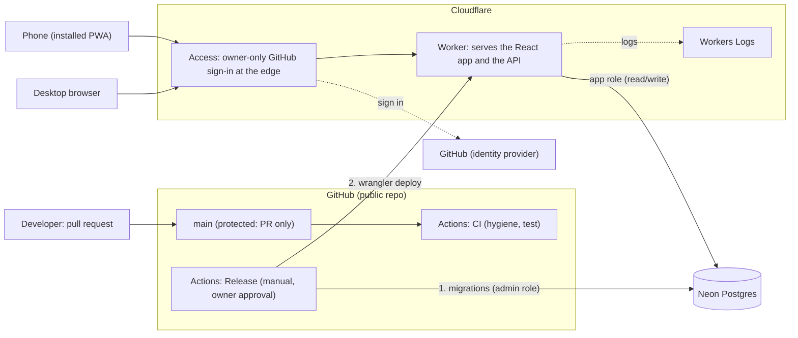
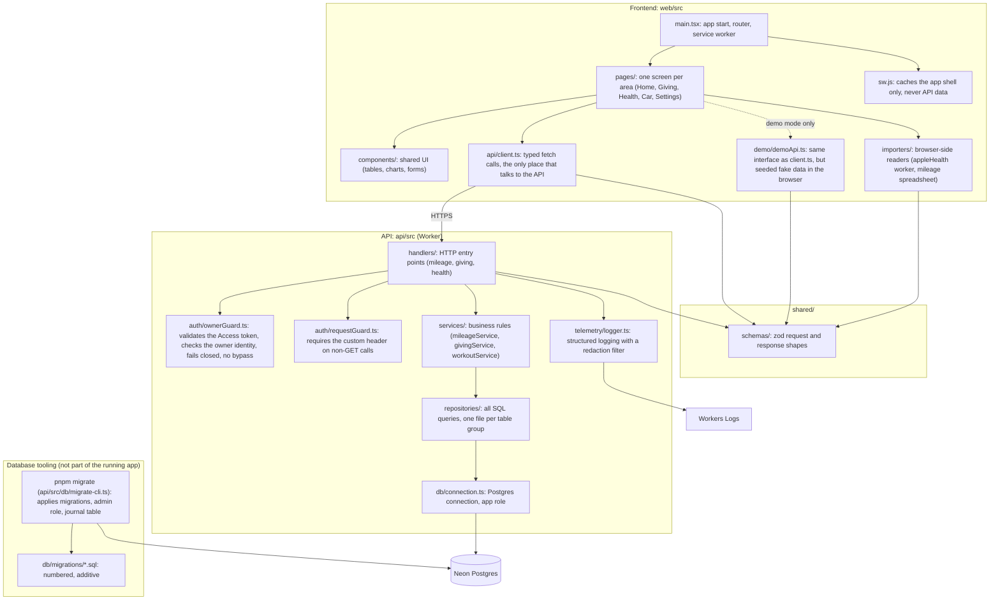
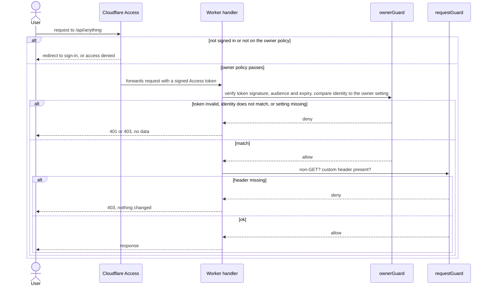
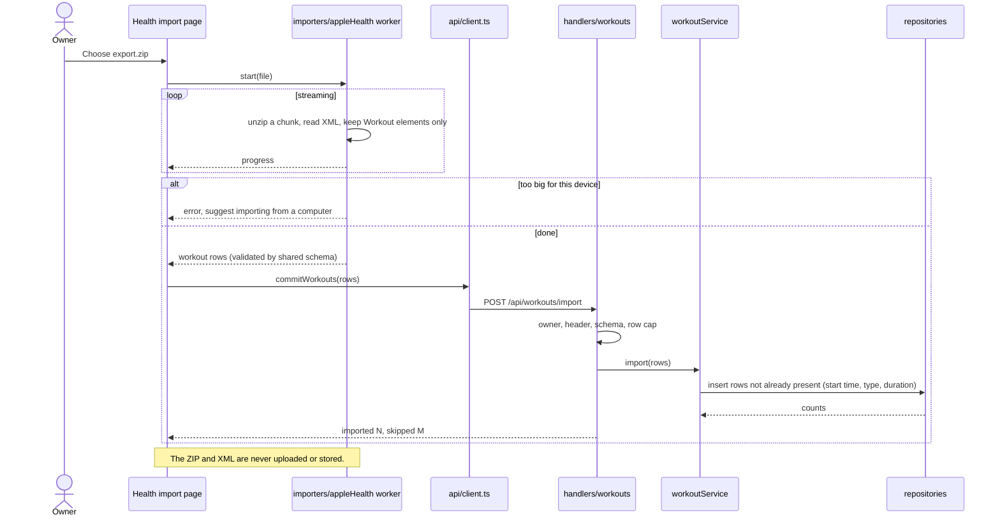
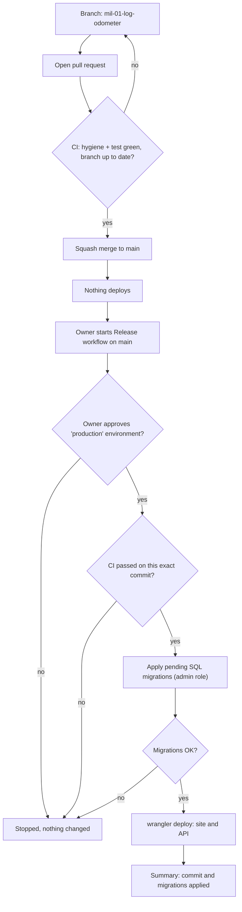
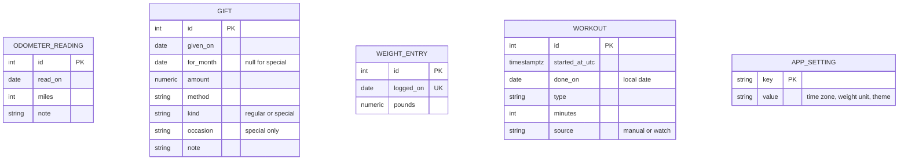

# Life Tracker: Architecture Diagrams (Draft v0.3)

All diagrams are [Mermaid](https://mermaid.js.org/) code blocks, so they render on GitHub and in VS Code (see the tool comparison at the bottom).

**Stack.** Decided in [DECISIONS.md](DECISIONS.md) (ADR-0021): a React app (Vite, PWA) served by a Cloudflare Worker that also runs the API (TypeScript, Hono), Cloudflare Access for the owner-only login, and Neon Postgres. A `shared/` package holds the zod schemas used by both sides. File names below are proposals. If a name changes, the structure still holds.

> **Migration in progress.** The code in the repo still targets Azure (Static Web Apps, Functions, Azure SQL) until stories MIG-02 to MIG-07 land. These diagrams show the target. Finance and transaction tracking are **not part of this app** (ADR-0021); they live in a separate private repository.

## 1. Deployment overview

Where things run, and who talks to whom. Note the two separate paths: users reach the app through the Cloudflare edge, and code reaches production only through the manual Release workflow.

Merging to `main` does not touch Cloudflare or Neon. Only the Release workflow does.

## 2. Main code files and what they do

Not every file, just the ones that carry the structure. Arrows point from a file to the thing it depends on. The rule that keeps this clean: **dependencies only point downward**, so nothing in `repositories/` ever imports from `handlers/`.

**One-line job of each layer**

| Layer | Job | Must not |
|---|---|---|
| `pages/`, `components/` | Draw screens, hold UI state | Call `fetch` directly |
| `importers/` | Read big or untrusted files in the browser (Apple Health, mileage spreadsheet) and output validated rows | Send the file anywhere |
| `api/client.ts` | Single doorway from the UI to the API | Contain business rules |
| `demo/demoApi.ts` | Stand-in for `client.ts` with fake data | Ever call the real API |
| `shared/schemas` | One definition of every request and response | Import from `web` or `api` |
| `handlers/` | Parse and validate the request, check the owner, call a service, shape the response | Contain SQL or business rules |
| `auth/ownerGuard.ts` | Reject anyone who is not the owner | Trust the edge check alone, or read an environment flag |
| `auth/requestGuard.ts` | Reject non-GET requests without the custom header | Contain any identity logic |
| `services/` | The rules: mileage weeks, giving totals, workout streaks, validation | Know about HTTP or SQL |
| `repositories/` | The only code that talks to SQL | Contain business rules |
| `telemetry/logger.ts` | One logging door, strips personal data | Log health values, odometer values, or gift amounts |
| `pnpm migrate` (`api/src/db/migrate-cli.ts`, runner in `api/src/db/`) | Apply SQL migrations with the admin role (`DATABASE_ADMIN_URL`). `db/` is the only place besides `repositories/` that imports the Postgres driver | Run inside the app |

A dependency check (dependency-cruiser) enforces these arrows in CI (AC-FND-03.6): handlers may not skip to repositories or `db`, services may not import `db`, only `repositories/` may use `db/`, and `db/` imports nothing above it. An ESLint rule rejects SQL text outside `repositories/`, `db/`, and tests (AC-FND-03.3; write SQL keywords in UPPER CASE so the rule can see them).

**Where each test level plugs in** (details in [TESTING.md](TESTING.md))

| Boundary | Test level |
|---|---|
| Inside `services/`, `shared/`, importers, guards, logger, components | Unit (in-memory fakes for repositories) |
| `repositories/` and `pnpm migrate` against a real Postgres | Integration |
| `handlers/` called with fake requests against a real Postgres | Integration |
| `pages/` against `demoApi`; `client.ts` and `demoApi.ts` against one contract suite | Integration |
| The built app in a browser through `wrangler dev` | End-to-end |

## 3. Sequence: every request is checked twice

This is the same for all endpoints. It is the "fail closed" rule from the spec. Tests use this same path with synthetic signed tokens. There is no test-only shortcut.

## 4. Sequence: importing from Apple Health (in the browser)

The big file never leaves the phone or computer. A background worker reads workouts from the ZIP, and only those rows are sent.

The mileage spreadsheet import (MIL-04) follows the same shape: the browser reads the file, shows a preview, and sends only validated readings to the API.

## 5. Flow: from change to production

## 6. Data model (ER diagram)

Only the tables the MVP needs. No raw files, and no financial or bank data (ADR-0021). Weekly mileage is computed from readings, not stored (ADR-0008). Every table also has created and updated timestamps, left out below.

`WORKOUT` has a unique index on (start time, type, minutes) so re-imports skip repeats. `WEIGHT_ENTRY` is unique per day. All tables stand alone for now, so they have no lines.

## 7. Tool comparison: which diagramming tool?

Your two requirements are (1) viewable in VS Code and (2) viewable on GitHub.

| Tool | GitHub renders it | VS Code | Diagram types | Notes |
|---|---|---|---|---|
| **Mermaid** | Yes, natively in any `.md` | Yes, with an extension (or built in, see below) | Flowchart, sequence, ER, state, class, Gantt, C4 (experimental), more | Diagram is plain text, so it diffs cleanly in Git. Layout is automatic and less controllable. |
| PlantUML | No (needs a server or pre-rendered images) | Yes, extension plus Java | Very wide range, best UML coverage | Extra setup and a build step to show on GitHub. |
| D2 | No | Extension exists | Flowcharts, architecture; prettier output | Needs pre-rendered SVGs committed to the repo. |
| draw.io (diagrams.net) | Only as exported images, or `.drawio.svg` files | Yes, official extension | Anything, drag and drop | Full layout control, but the source is XML, so Git diffs are unreadable. |
| Excalidraw | Only as exported images | Yes, extension | Hand-drawn sketches | Good for whiteboarding, not for maintained docs. |
| Structurizr (C4) | No | Limited | Proper C4 architecture model | Powerful but heavy for a one-person project. |

**Recommendation: stay with Mermaid.** It is the only option that meets both requirements with no build step, and for a portfolio repo it shows reviewers the diagrams right on the README page. Mermaid is a good fit for every diagram type you asked for. Use draw.io only if you ever need a polished, hand-laid-out poster diagram, and commit it as a `.drawio.svg`.

**Viewing in VS Code:** install the extension *Markdown Preview Mermaid Support* (`bierner.markdown-mermaid`), then open the Markdown preview with `Cmd+Shift+V`. Without an extension, the built-in preview shows the code, not the picture.

**Other diagram types worth keeping up to date**

| Diagram | Why it helps | Included here |
|---|---|---|
| Deployment overview | Shows hosting, release path, and cost surface | Section 1 |
| Dependency graph | Keeps layers clean | Section 2 |
| Sequence | Follows one action across modules | Sections 3, 4 |
| Change-to-production flow | Shows the gates between a commit and real data | Section 5 |
| ER | Agrees on tables before writing SQL | Section 6 |
| State | Catches missing failure paths in multi-step flows | Add when a multi-step flow needs one |
| Screen flow (navigation map) | Later, once wireframes settle | Not yet |
