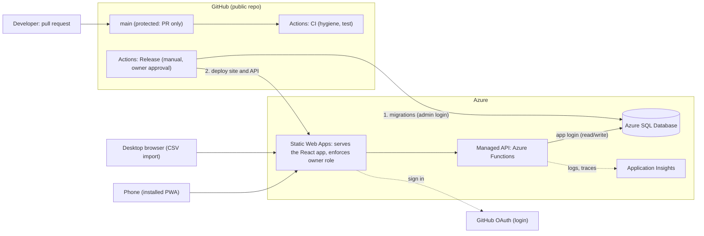
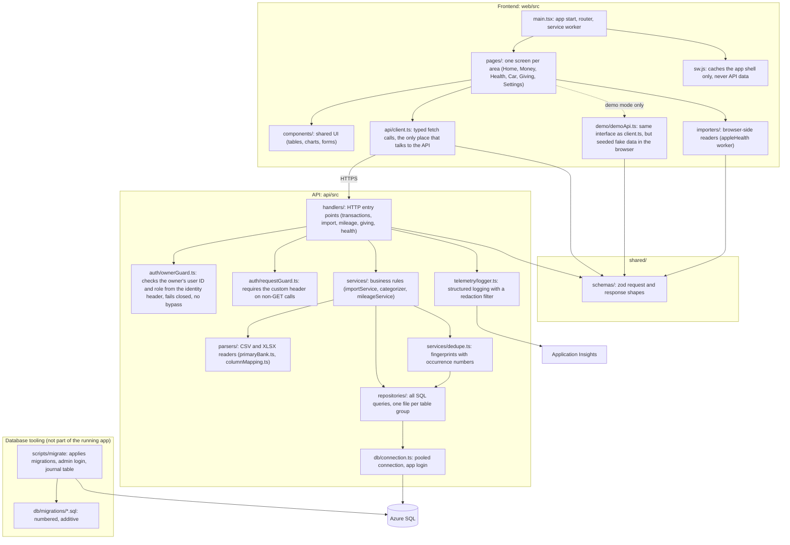
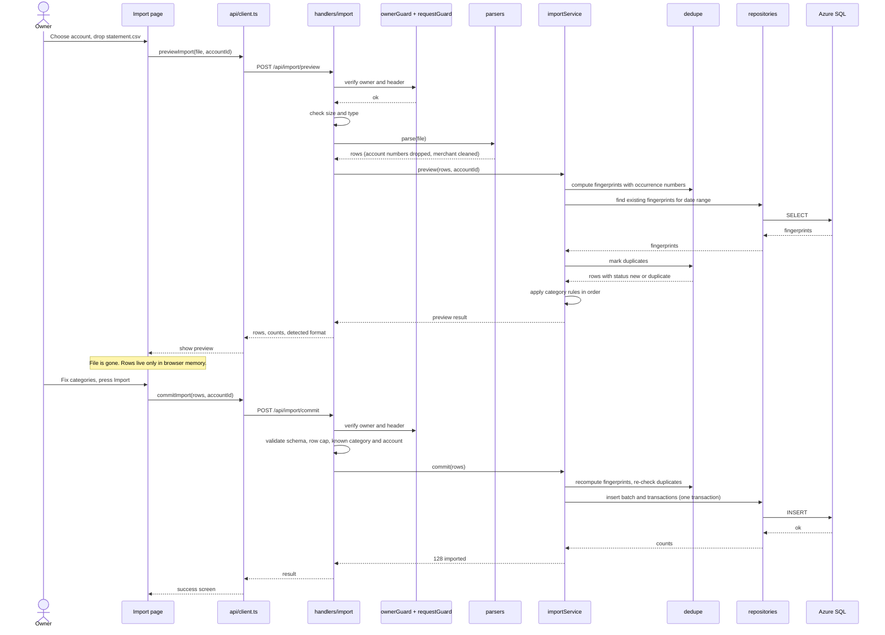
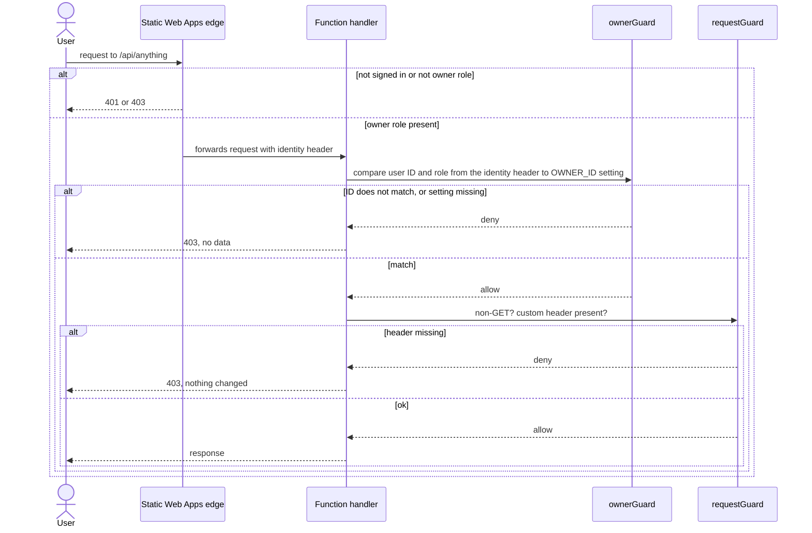
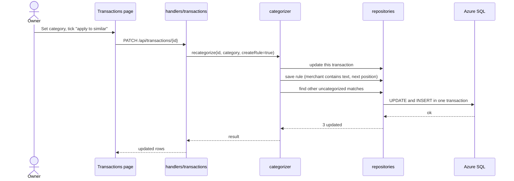
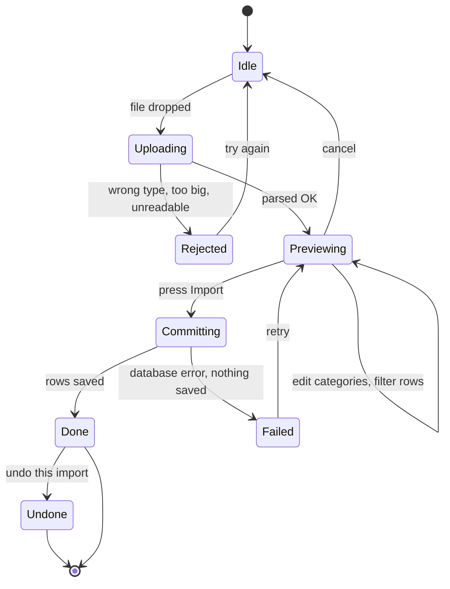
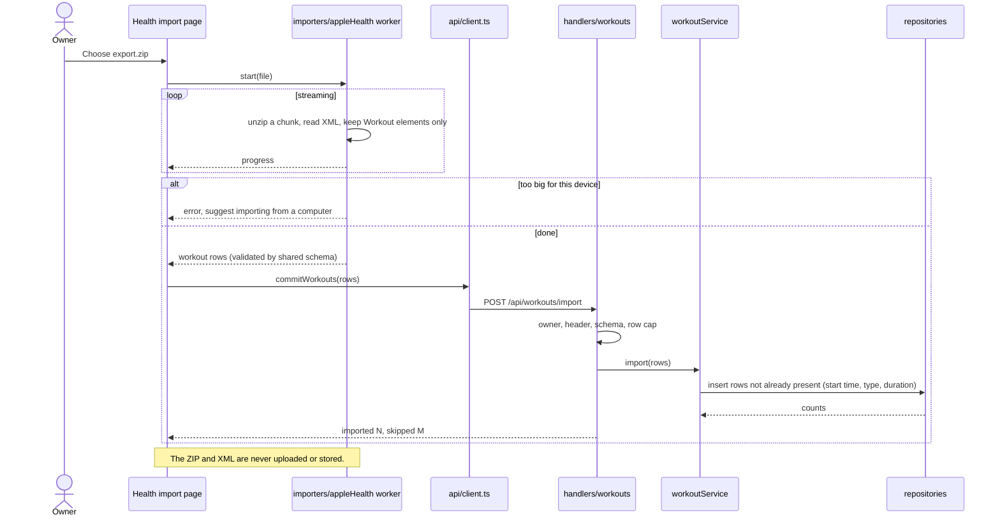
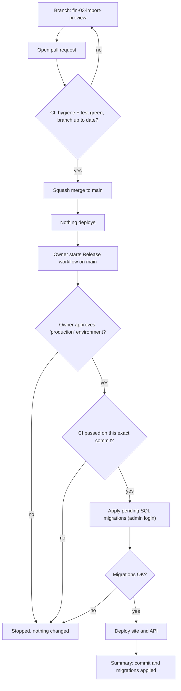
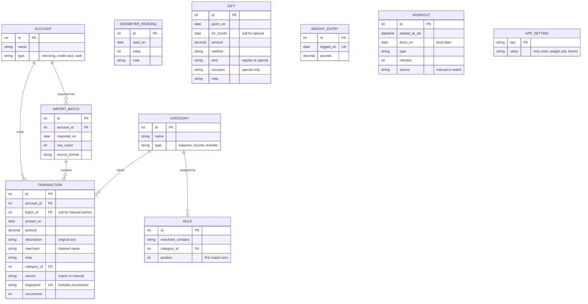

# Life Tracker: Architecture Diagrams (Draft v0.2)

All diagrams are [Mermaid](https://mermaid.js.org/) code blocks, so they render on GitHub and in VS Code (see the tool comparison at the bottom).

**Stack.** Decided in [DECISIONS.md](DECISIONS.md): a React app (Vite, PWA) on Azure Static Web Apps, its managed API on Azure Functions (TypeScript), and Azure SQL. A `shared/` package holds the zod schemas used by both sides. File names below are proposals. If a name changes, the structure still holds.

## 1. Deployment overview

Where things run, and who talks to whom. Note the two separate paths: users reach the app through the hosting edge, and code reaches production only through the manual Release workflow.

Merging to `main` does not touch Azure. Only the Release workflow does.

## 2. Main code files and what they do

Not every file, just the ones that carry the structure. Arrows point from a file to the thing it depends on. The rule that keeps this clean: **dependencies only point downward**, so nothing in `repositories/` ever imports from `handlers/`.

**One-line job of each layer**

| Layer | Job | Must not |
|---|---|---|
| `pages/`, `components/` | Draw screens, hold UI state | Call `fetch` directly |
| `importers/` | Read big files in the browser (Apple Health) and output validated rows | Send the file anywhere |
| `api/client.ts` | Single doorway from the UI to the API | Contain business rules |
| `demo/demoApi.ts` | Stand-in for `client.ts` with fake data | Ever call the real API |
| `shared/schemas` | One definition of every request and response | Import from `web` or `api` |
| `handlers/` | Parse and validate the request, check the owner, call a service, shape the response | Contain SQL or business rules |
| `auth/ownerGuard.ts` | Reject anyone who is not the owner | Trust the edge check alone, or read an environment flag |
| `auth/requestGuard.ts` | Reject non-GET requests without the custom header | Contain any identity logic |
| `services/` | The rules: categorize, dedupe, mileage weeks, validation | Know about HTTP or SQL |
| `parsers/` | Turn a file into clean row objects, drop account numbers | Write to the database |
| `repositories/` | The only code that talks to SQL | Contain business rules |
| `telemetry/logger.ts` | One logging door, strips personal data | Log amounts, merchants, or health values |
| `scripts/migrate` | Apply SQL migrations with the admin login | Run inside the app |

A dependency check (dependency-cruiser) enforces these arrows in CI (AC-FND-03.6).

**Where each test level plugs in** (details in [TESTING.md](TESTING.md))

| Boundary | Test level |
|---|---|
| Inside `services/`, `parsers/`, `shared/`, guards, logger, components | Unit (in-memory fakes for repositories) |
| `repositories/` and `scripts/migrate` against a real SQL Server | Integration |
| `handlers/` called with fake requests against a real SQL Server | Integration |
| `pages/` against `demoApi`; `client.ts` and `demoApi.ts` against one contract suite | Integration |
| The built app in a browser through the SWA CLI | End-to-end |

## 3. Sequence: uploading a CSV

Import is two calls. Nothing is saved on the first one. The browser holds the parsed rows between the calls, so the server never stores the file. Because those rows come back from the browser, the commit call treats them as untrusted input.

Why re-check duplicates on commit: another import could have happened between preview and commit, and the database also has a unique index on the fingerprint as the final safety net. Undoing an import deletes the rows that belong to one batch (FIN-09).

## 4. Sequence: every request is checked twice

This is the same for all endpoints. It is the "fail closed" rule from the spec. Tests use this same path with synthetic identity headers. There is no test-only shortcut.

## 5. Sequence: fixing a category and "teaching the app"

## 6. State diagram: life of an import

## 7. Sequence: importing from Apple Health (in the browser)

The big file never leaves the phone or computer. A background worker reads workouts from the ZIP, and only those rows are sent.

## 8. Flow: from change to production

## 9. Data model (ER diagram)

Only the tables the MVP needs. No account numbers, no raw files. Weekly mileage is computed from readings, not stored (ADR-0008). Every table also has created and updated timestamps, left out below.

`WORKOUT` has a unique index on (start time, type, minutes) so re-imports skip repeats. The last few tables stand alone for now, so they have no lines.

## 10. Tool comparison: which diagramming tool?

Your two requirements are (1) viewable in VS Code and (2) viewable on GitHub.

| Tool | GitHub renders it | VS Code | Diagram types | Notes |
|---|---|---|---|---|
| **Mermaid** | Yes, natively in any `.md` | Yes, with an extension (or built in, see below) | Flowchart, sequence, ER, state, class, Gantt, C4 (experimental), more | Diagram is plain text, so it diffs cleanly in Git. Layout is automatic and less controllable. |
| PlantUML | No (needs a server or pre-rendered images) | Yes, extension plus Java | Very wide range, best UML coverage | Extra setup and a build step to show on GitHub. |
| D2 | No | Extension exists | Flowcharts, architecture; prettier output | Needs pre-rendered SVGs committed to the repo. |
| draw.io (diagrams.net) | Only as exported images, or `.drawio.svg` files | Yes, official extension | Anything, drag and drop | Full layout control, but the source is XML, so Git diffs are unreadable. |
| Excalidraw | Only as exported images | Yes, extension | Hand-drawn sketches | Good for whiteboarding, not for maintained docs. |
| Structurizr (C4) | No | Limited | Proper C4 architecture model | Powerful but heavy for a one-person project. |

**Recommendation: stay with Mermaid.** It is the only option that meets both requirements with no build step, and for a portfolio repo it shows reviewers the diagrams right on the README page. Mermaid is a good fit for every diagram type you asked for. Use draw.io only if you ever need a polished, hand-laid-out poster diagram, and commit it as a `.drawio.svg`.

**Viewing in VS Code:** install the extension *Markdown Preview Mermaid Support* (`bierner.markdown-mermaid`), then open the Markdown preview with `Cmd+Shift+V`. Without an extension, the built-in preview shows the code, not the picture.

**Other diagram types worth keeping up to date**

| Diagram | Why it helps | Included here |
|---|---|---|
| Deployment overview | Shows hosting, release path, and cost surface | Section 1 |
| Dependency graph | Keeps layers clean | Section 2 |
| Sequence | Follows one action across modules | Sections 3, 4, 5, 7 |
| State | Catches missing failure paths in multi-step flows | Section 6 |
| Change-to-production flow | Shows the gates between a commit and real data | Section 8 |
| ER | Agrees on tables before writing SQL | Section 9 |
| Screen flow (navigation map) | Later, once wireframes settle | Not yet |
