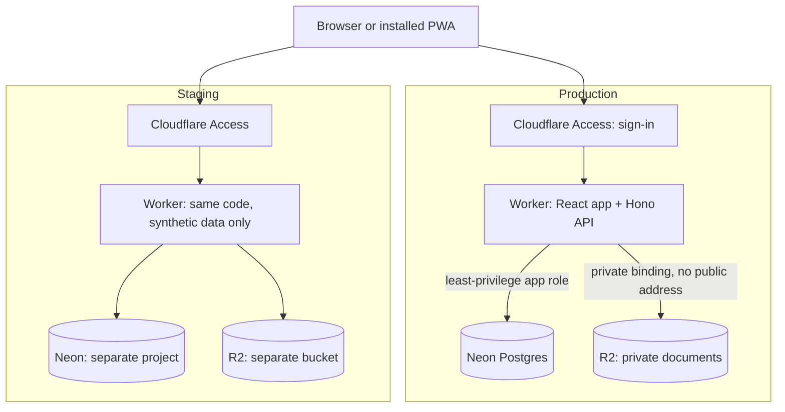
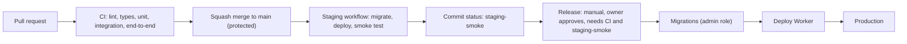
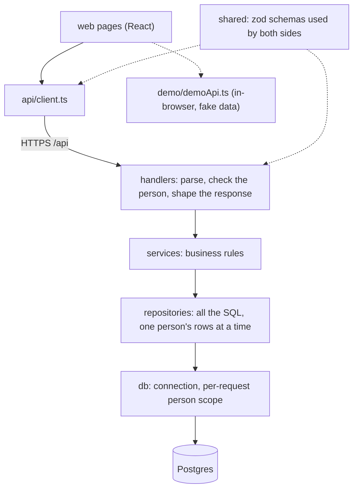
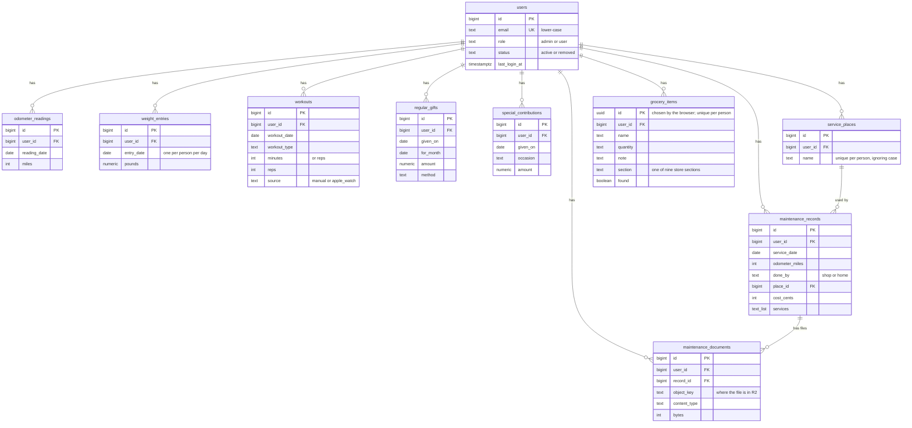

# Life Tracker

[](https://github.com/githubacct54385/life-tracker/actions/workflows/ci.yml?query=branch%3Amain) [](https://github.com/githubacct54385/life-tracker/security/code-scanning) [](https://github.com/githubacct54385/life-tracker/blob/main/LICENSE) [](https://github.com/githubacct54385/life-tracker/actions/workflows/ci.yml?query=branch%3Amain) [](https://github.com/githubacct54385/life-tracker/actions/workflows/ci.yml?query=branch%3Amain)

A web app (installable PWA) for health, mileage, and giving. It is used by its owner and by a few invited people, each with their own private data. Finance is not part of this app. The code is public. Sign-in is by invitation only. A demo with fake data runs entirely in the browser.

**Status:** in daily use by its owner. Running on Cloudflare Workers and Neon Postgres (ADR-0021) with a staging environment (ADR-0025) and a manual, approved release. Sign-in for invited people, with each person's data kept separate, is being built now (ADR-0026). Stories are tracked in Linear.

## What it does

- **Car:** log the odometer in seconds, see weekly mileage with graphs and a rolling average, import a mileage spreadsheet, and keep a maintenance log with history and private document storage for receipts.
- **Health:** log weight and see the trend, and log workouts such as push-ups.
- **Giving:** log charitable giving by month, including special contributions, with a history.
- **Home:** one phone-sized dashboard with the latest weight, last week's miles, workouts this week and giving so far this year, plus quick actions.
- **Groceries:** one shopping list, grouped by store section, tick items off as you find them, and finish the trip to clear it. It keeps working with no signal in the shop and sends your changes when the signal returns.
- **Everywhere:** installable as a PWA, works at phone, tablet and desktop widths, and has light, dark and system themes.
- **Demo:** a mileage import walkthrough and the grocery list, on made-up data, running entirely in the browser at `/demo`. A full demo of every screen is planned (SET-10).

## What I would point to

- **Invitation-only sign-in and a fail-closed API.** If a request cannot be tied to an active, invited person, it gets nothing, and one person can never reach another person's data. A test lists every route and fails if one is missing ([ADR-0026](DECISIONS.md#adr-0026-the-app-owns-its-people-google-sign-in-invitations-and-per-person-data)).
- **A layered architecture that the build enforces.** Pages call the API client, then handlers, services, repositories and the database. `dependency-cruiser` fails the build if a dependency points up, and SQL lives only in repositories ([ARCHITECTURE.md](ARCHITECTURE.md)).
- **Tests carried by acceptance-criterion IDs.** Every test name starts with the criterion it proves, such as `[AC-MIL-04.4]`, and a script reports criteria with no test and tests that point at unknown criteria ([TESTING.md](TESTING.md)).
- **A manual release with approval.** Merging never deploys. The Release workflow waits for CI and the staging smoke test on that exact commit, waits for the owner's approval, applies migrations, then deploys ([ADR-0004](DECISIONS.md#adr-0004-source-control-pull-requests-and-manual-release), [ADR-0025](DECISIONS.md#adr-0025-a-staging-environment-sits-in-front-of-production)).
- **Private document storage.** Receipts are kept in a private Cloudflare R2 bucket, per person, with size and type limits, and are never served from a public address ([ADR-0024](DECISIONS.md#adr-0024-maintenance-documents-are-stored-privately-in-cloudflare-r2)).
- **Migrations that are safe to release.** They add first, the code switches next, and old things are removed in a later release. CI fails on a destructive statement without an explicit marker ([docs/multi-person-plan.md](docs/multi-person-plan.md)).
- **A deliberate, narrow privacy exception.** The app stores nothing about you on your device, except the grocery list so it works offline. It sits behind one small module, is deleted at sign-out and when the trip is finished, and a test proves nothing else is saved ([ADR-0027](DECISIONS.md#adr-0027-the-grocery-list-is-kept-on-the-device-so-it-works-with-no-signal)).
- **A demo that can never touch real data.** The demo and the real client implement one interface and share a contract test suite ([ADR-0014](DECISIONS.md#adr-0014-demo-parity)).

## Tech stack

| Part | Choice | Why |
|---|---|---|
| Web app | React, TypeScript, Vite, React Router, TanStack Query, Tailwind | Common, well documented and quick to build with ([ADR-0012](DECISIONS.md#adr-0012-frontend-and-tooling-stack)) |
| Charts | Recharts | Fast to build with; text alternatives and colours are checked by tests ([ADR-0012](DECISIONS.md#adr-0012-frontend-and-tooling-stack)) |
| API | Hono on a Cloudflare Worker | One small deploy serves the site and `/api/*` on a free plan ([ADR-0021](DECISIONS.md#adr-0021-move-to-cloudflare-workers--neon-postgres-and-move-finance-out-of-this-app)) |
| Database | Neon Postgres, hand-written SQL with `pg`, numbered `.sql` migrations | Real Postgres on a free plan, with SQL that is easy to read and review ([ADR-0002](DECISIONS.md#adr-0002-data-access-and-migrations)) |
| Validation | zod, shared by the browser and the API | One definition of every request and response ([ADR-0012](DECISIONS.md#adr-0012-frontend-and-tooling-stack)) |
| File storage | Cloudflare R2 (private) | Free tier, and nothing is public ([ADR-0024](DECISIONS.md#adr-0024-maintenance-documents-are-stored-privately-in-cloudflare-r2)) |
| Sign-in | Google sign-in with an app-owned list of people (being built), Cloudflare Access until then | No passwords to store, and the owner manages people in the app ([ADR-0026](DECISIONS.md#adr-0026-the-app-owns-its-people-google-sign-in-invitations-and-per-person-data)) |
| Tests | Vitest, Testing Library, fast-check, Testcontainers, Playwright | A pyramid: many unit tests, fewer integration tests against real Postgres, few end-to-end tests ([ADR-0005](DECISIONS.md#adr-0005-testing-strategy)) |
| Delivery | GitHub Actions, protected `main`, a staging environment, a manual approved Release | Nothing reaches production without green checks and the owner's approval ([ADR-0004](DECISIONS.md#adr-0004-source-control-pull-requests-and-manual-release), [ADR-0025](DECISIONS.md#adr-0025-a-staging-environment-sits-in-front-of-production)) |
| Architecture rules | `dependency-cruiser` and ESLint | The layers are enforced by the build, not by habit ([ADR-0012](DECISIONS.md#adr-0012-frontend-and-tooling-stack)) |

## How it fits together

Rendered by GitHub. The same diagrams, with more detail and the request sequences, are in [ARCHITECTURE.md](ARCHITECTURE.md).

### System architecture

A browser talks to one Cloudflare Worker that serves the React app and the API. Production and staging are separate copies of the whole stack, so a change is tried on staging with synthetic data before it can reach production.



### From a change to production

Merging never deploys. Staging deploys on its own after CI passes, and the production Release is manual, needs the owner's approval, and refuses a commit that has not passed CI and the staging smoke test.



### Code layers

Dependencies point downward only, and `dependency-cruiser` fails the build if one points up. SQL lives in repositories and business rules in services. Demo mode swaps the API client for an in-browser one with the same interface, so the demo never calls the real API.



### Data model

Every table that holds a person's data has a `user_id`, and every query is limited to the signed-in person (ADR-0026). Weekly mileage is computed from readings, not stored. No files are stored in the database; documents live in the private R2 bucket and the table keeps only a key.



## Read first

| Document | What it covers |
|---|---|
| [SPEC.md](SPEC.md) | Features, priorities, security requirements |
| [ARCHITECTURE.md](ARCHITECTURE.md) | Layers, dependency rules, diagrams |
| [DECISIONS.md](DECISIONS.md) | Why each technical choice was made |
| [TESTING.md](TESTING.md) | The test pyramid and CI |
| [OBSERVABILITY.md](OBSERVABILITY.md) | Logging rules |
| [docs/setup.md](docs/setup.md) | Set up Neon, Cloudflare and GitHub from scratch |
| [docs/staging-setup.md](docs/staging-setup.md) | Set up the staging environment (OPS-08) |
| [docs/local-docker.md](docs/local-docker.md) | Install Docker, and how it is used for local databases and tests |
| [docs/privacy.md](docs/privacy.md) | What is stored about a person and how it is deleted |
| [docs/ac-ids.txt](docs/ac-ids.txt) | Valid acceptance-criterion IDs (the stories and criteria text are in Linear) |
| [AGENTS.md](AGENTS.md) | Working rules for contributors and AI coding agents |

## Run it locally

```bash
pnpm install
printf 'DATABASE_URL=<app-role connection string, local or Neon branch>\n' > api/.dev.vars   # git-ignored; never commit it
pnpm dev          # builds the web app, then `wrangler dev` serves web + API at http://localhost:8787
pnpm dev:web      # optional: Vite with hot reload at http://localhost:5173, forwarding /api to the Worker
```

Check it works: open http://localhost:8787 (the web app loads) and http://localhost:8787/demo (the demo, which needs no sign-in).

The API fails closed. Without a valid Cloudflare Access token, every `/api` route answers 401, `/api/health` included ([ADR-0006](DECISIONS.md#adr-0006-auth-testing-and-request-protection)). So `curl localhost:8787/api/health` returns `{"error":"unauthorized"}` unless you have set up Access. To use the API locally, run `pnpm test:e2e`, which signs synthetic tokens with a throwaway key. To sign in to `pnpm dev` yourself, add the three Access settings to `api/.dev.vars` ([docs/cloudflare-access-setup.md](docs/cloudflare-access-setup.md)). No Cloudflare login is needed for either.

Wireframes: [the full suite at mobile, tablet, and desktop widths](wireframes-suite.html).

## Run the tests locally

All three levels run on a Mac (Apple Silicon or Intel) and on Linux. CI runs the same commands, so a green run here is a good sign. The steps were written and checked on Linux, and nothing in them is Linux-only, so tell us if a step differs on your Mac.

**Once:** install Node 22 or newer (`brew install node@22`), then pnpm with `corepack enable` (the repo pins the pnpm version), then `pnpm install`.

| Level | Command | What it needs | Time |
|---|---|---|---|
| Unit, plus lint and types | `pnpm test:unit`, `pnpm lint`, `pnpm typecheck` | Nothing else | under a minute |
| Integration (real Postgres) | `pnpm test:int` | A running Docker | a few minutes the first time |
| End to end (real browser) | `pnpm test:e2e` | Chromium, and a local Postgres for the full-stack part | a few minutes |
| All of them, as CI does | `pnpm test` | All of the above | |

### Unit tests
No setup. `pnpm test:unit` runs the shared, api, web and scripts tests. Run one package with `pnpm --filter web test:unit` (or `api`, `shared`). Add a file name to run one test file, for example `pnpm --filter web test:unit ServiceDocuments`.

### Integration tests
These start a throwaway Postgres in a container and apply the real migrations to it, so they need a Docker that is running.

1. Install and start Docker Desktop (or OrbStack, or Colima). Step by step: [docs/local-docker.md](docs/local-docker.md).
2. `pnpm test:int`

The first run downloads the Postgres image. The database is created per run and removed afterwards, so nothing is left behind and nothing of yours is touched. **If Docker is not found, these tests are skipped with a warning, and they show as passed.** Look for "database tests are SKIPPED" in the output. CI never skips them. With Colima, run `colima start` first, and set `DOCKER_HOST` to its socket if the tests cannot find it.

### End-to-end tests
These build the site, start the real Worker (`wrangler dev`), and drive Chromium with Playwright. No Cloudflare login is needed.

1. Once: `pnpm --filter web exec playwright install chromium`
2. For the full-stack specs (`web/e2e/stack/`) you also need a local Postgres, which the tests fill with the real migrations. The easiest way is a Docker container (one command, see [docs/local-docker.md](docs/local-docker.md)). Or with Homebrew:

```bash
brew install postgresql@16
brew services start postgresql@16
createdb lt_e2e
export E2E_ADMIN_DATABASE_URL="postgresql://$(whoami)@127.0.0.1:5432/lt_e2e"
```

3. `pnpm test:e2e`

To run one spec: `pnpm --filter web exec playwright test e2e/stack/maintenance.spec.ts`. To watch it in a visible browser, add `--headed`. A failed test leaves notes about the page under `web/test-results/`.

Things to know:
- **Without `E2E_ADMIN_DATABASE_URL`** the full-stack specs are skipped (with a message) and the screen-check specs (layout, accessibility) still run.
- **Use a database that only the tests use.** Its name must contain `e2e` and it must be on your computer, or the tests refuse to start. They **empty it at the start of every run**.
- **They change `api/.dev.vars`.** The tests replace the `DATABASE_URL` line there with the test database's login (other lines are left alone), and remove it when `E2E_ADMIN_DATABASE_URL` is not set. If you use `.dev.vars` for `pnpm dev`, save your own `DATABASE_URL` line first and put it back afterwards.
- **Ports 8788 and 9099** must be free. Close any other copy of the tests first, because two runs at once break each other.
- Document uploads use the local R2 that `wrangler dev` provides, so no Cloudflare bucket is touched.

More about what each level covers is in [TESTING.md](TESTING.md).

## How changes reach production

1. Branch from `main`, named after the story (`mil-03-mileage-graphs`).
2. Open a pull request. CI must pass and the branch must be up to date.
3. Squash merge. **Merging does not deploy.**
4. The owner starts the **Release** workflow, approves it, and it applies database migrations and then deploys.

`main` accepts no direct pushes.

## Privacy

No real data is stored in this repository, and none may be. Test and demo data is synthetic and generated in code. See hard rules in [AGENTS.md](AGENTS.md). To report a security problem, see [SECURITY.md](SECURITY.md).

## License

[MIT](LICENSE)
